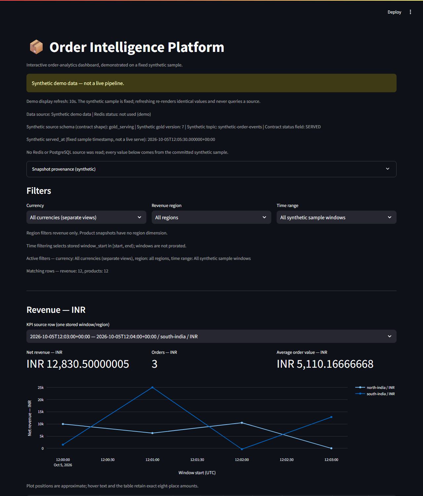
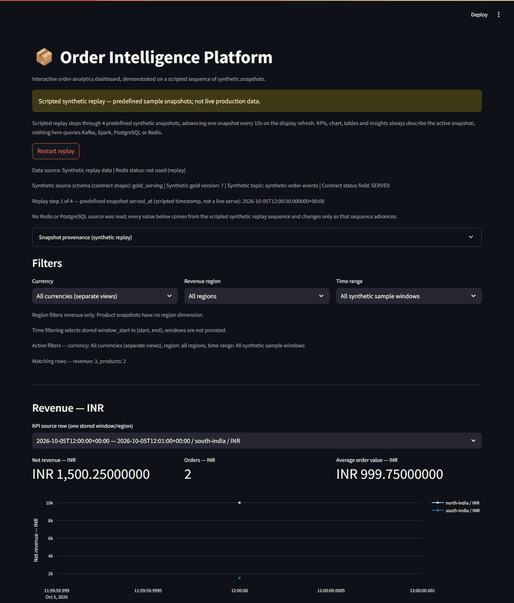

# Order Intelligence Platform

> **Real-time order and revenue intelligence platform**  
> Built with Apache Kafka (KRaft), Apache Spark Structured Streaming, MinIO Data Lake (Bronze/Silver/Gold), PostgreSQL, Redis, Prometheus, and Grafana.

[](#architecture)
[](https://kafka.apache.org)
[](#build-roadmap)

---

## See it in 60 seconds

This is a real-time order/revenue analytics platform: order events flow through
Kafka → Spark Structured Streaming → a Bronze/Silver/Gold data lake → PostgreSQL/Redis
→ a live Streamlit dashboard, plus one-shot rule-based alert evaluation and
observability. You can see
the dashboard **without any of that infrastructure** using the built-in synthetic
demo — a fixed, clearly-labelled sample dataset rendered through the real read and
render path.

📸 _Fixed synthetic demo (the default, no services required):_



🎞️ _Optional scripted replay (the same page stepping through four predefined
synthetic snapshots — still 100% synthetic, not live ingestion):_



Fastest look (from the repository root, after the demo setup below — no Docker,
Kafka, Spark, PostgreSQL or Redis):

```bash
python -m dashboard.demo
```

Both images show **synthetic demo data**, not a live production pipeline; the
dashboard itself states this on every view. See the
[Synthetic demo](#synthetic-demo-no-infrastructure-required) section for the exact
Python 3.11 launch steps and the fixed-vs-scripted distinction, and the sections
below for the full architecture, testing and provenance details.

---

## What this project is

This platform replicates the real-time order processing pipeline used by companies like Flipkart, Swiggy, and Amazon — ingesting order lifecycle events through Kafka, processing them with Spark Structured Streaming, storing them in a three-layer data lake (Bronze/Silver/Gold) on MinIO, computing business KPIs into PostgreSQL, and surfacing them on a live Streamlit dashboard. Alerting is one-shot, currency-aware **rule evaluation** against the served Gold results (M7), persisted in PostgreSQL and consumed by a controlled-HTTP notification path (M8); no statistical anomaly detection runs in the shipped entry points — see [Alert path](#alert-path-as-implemented).

It is built phase-by-phase, with each phase reviewed against Staff Data Engineer standards before the next begins.

> **Certification scope.** M1-M9 and Phase C were verified in a local Docker
> Compose environment on a single machine. This is a portfolio reference
> implementation, not a certified production deployment. High availability,
> disaster recovery, cloud/on-prem certification and load testing are out of
> scope; CI/CD is limited to a minimal workflow that runs the self-contained
> unit suites (no build, deploy or hosted-service automation). No end-to-end exactly-once delivery guarantee
> is claimed; the data-quality/DLQ path is documented as at-least-once.
### Verified pipeline status

The historical roadmap below is not a runtime acceptance report. See
`milestone1_current_real_world_review_report.md` for the verified Avro/Spark baseline
and `milestone2_bronze_dq_silver_dlq_report.md` for the Bronze → DQ → Silver/DLQ result.
The current [DQ and Silver contract](data_quality/CONTRACT.md) defines 21 explicit
checks, source-coordinate replay handling, durable MinIO audit records and
at-least-once Kafka DLQ delivery. The older “10 checks” and business-key dedup
descriptions are superseded by that contract.

Gold's current [contract](streaming/GOLD_CONTRACT.md) retains the one-minute
regional revenue and five-minute product metrics, separated by currency. It uses
exact decimal arithmetic and committed full snapshots for cross-batch/replay
correctness. Read through `storage.gold_store.read_gold`; do not union historical
snapshot directories. See `milestone3_silver_gold_report.md` for runtime evidence.
The Gold job no longer invokes PostgreSQL directly. Milestone 4 serves the
authoritative committed Gold manifest into the additive `gold_serving` PostgreSQL
schema without changing the legacy `gold.*` consumers. See
`milestone4_gold_postgres_report.md` for runtime evidence and serving constraints.

Milestone 5 adds a rebuildable Redis cache sourced only from authoritative M4
PostgreSQL. Use `python -m storage.postgres_redis_serving` with the existing
environment loaded. The default source is `gold_serving`; the default Redis
namespace is `oip:m5:gold-serving`. See the
[Redis serving contract](storage/REDIS_SERVING_CONTRACT.md) and
[M5 evidence report](milestone5_postgres_redis_report.md).

Milestone 6 migrates the Streamlit dashboard to that M5 snapshot with read-only
`gold_serving` fallback. Revenue/product views preserve currencies, full row
identities and exact monetary text, and display source/version provenance.
See [M6 verification](milestone6_dashboard_report.md).

From this project root, with environment configuration loaded:

```bash
python -m streamlit run dashboard/app.py
```

The source schema must be `gold_serving`; Redis defaults to
`oip:m5:gold-serving`. `DASHBOARD_DEFAULT_CURRENCY` is optional; by default each
currency gets a separate view. Redis errors/misses fall back to PostgreSQL;
valid cached data is explicitly labeled without claiming current freshness.

Milestone 7 adds one-shot, currency-aware alert evaluation from authoritative
`gold_serving`, with PostgreSQL-persisted decisions, cooldowns and firing events:

```bash
python main.py alerts --rules alerts/rules.example.json
```

Rules require explicit currency, dimensions, thresholds, severity and cooldown.
The example is a reviewable verification configuration, not an implicit business
policy. No notifications are sent. See [M7 alert contract](alerts/CONTRACT.md)
and [M7 verification report](milestone7_alerts_report.md).

Milestone 8 consumes persisted M7 firing events through a bounded one-shot
notification processor. PostgreSQL stores deterministic requests, attempt history,
leased claims and retry schedules. Its single provider is a **CONTROLLED/TEST HTTP
receiver**, with real loopback HTTP and durable idempotency receipts.
**External provider delivery is not certified in this environment.**

With explicit `NOTIFICATION_PROVIDER=controlled_http`, `NOTIFICATION_ENDPOINT`
and logical `NOTIFICATION_DESTINATION` environment configuration:

```bash
python main.py notifications
# Separate stages are also available:
python -m notifications.service --mode generate
python -m notifications.service --mode deliver
```

The CLI reads `alerts_serving.alert_events`; it never reevaluates alert conditions.
See the [M8 contract](notifications/CONTRACT.md) and
[M8 verification report](milestone8_notifications_report.md) for retry, recovery,
provider boundaries and retained evidence.

### Milestone 9 — operational observability

M9 is **PASS and frozen**, with real Prometheus/Grafana checks and M1–M8
runtime regressions. Its recorded test evidence is a 202-test run that passed on
2026-10-04 inside a Linux verification container with the local serving stack
reachable — an environment this repository does not reproduce on its own; see
[Testing and verification](#testing-and-verification). See the [M9 report](milestone9_observability_report.md) and
[observability contract](observability/CONTRACT.md) for the metric inventory,
failure/recovery evidence and interpretation limits.

```text
Python/Spark lifecycle observations ── bounded asynchronous HTTP ─┐
PostgreSQL/Redis metadata + dependency health ── periodic probes ─┤
                                                               ▼
                                                        metrics-exporter
                                                               │ /metrics
                                                         Prometheus
                                                               │
                                                three Grafana dashboards
```

From the project root, with the existing `.env` and M1–M8 serving sources prepared:

```bash
docker compose up -d kafka schema-registry minio postgres redis
docker compose up -d --build metrics-exporter prometheus grafana
```

Set `OIP_DASHBOARD_HEALTH_URL` in `.env` to the actual running Streamlit health
endpoint before starting the exporter. The verification default points at
`oip-modernization-verify:8501`; Compose does not create that application container.
For host-run Streamlit on Docker Desktop, use
`http://host.docker.internal:8501/_stcore/health` and start Streamlit with
`--server.address=0.0.0.0`. An absent dashboard correctly degrades exporter readiness.

Enable lifecycle metrics explicitly in each application process, using its
existing business configuration and command. For a host process:

```bash
export OIP_TELEMETRY_URL=http://127.0.0.1:8000/observe
python -m streamlit run dashboard/app.py --server.address=0.0.0.0
```

For processes on the Compose network, use
`OIP_TELEMETRY_URL=http://metrics-exporter:8000/observe`; propagate it to Spark
executors where applicable. An unset value disables telemetry. Starting the
exporter alone observes dependency metadata, not historical application activity.

| Operator view | Default URL |
|---|---|
| Metrics exposition | http://127.0.0.1:8000/metrics |
| Exporter liveness / readiness | http://127.0.0.1:8000/healthz / http://127.0.0.1:8000/readyz |
| Prometheus targets | http://127.0.0.1:9090/targets |
| Platform Overview (12 panels) | http://127.0.0.1:3000/d/oip-platform |
| Data Pipeline (8 panels) | http://127.0.0.1:3000/d/oip-pipeline |
| Serving & Delivery (9 panels) | http://127.0.0.1:3000/d/oip-serving-delivery |

Grafana uses the existing `.env` admin credentials and provisioned datasource
`prometheus-oip`. The three verified scrape jobs are `oip`, `prometheus` and
`grafana`; the static Prometheus YAML sets the 5-second interval. Operational
metrics use fixed labels and contain counts, durations and metadata, not money or
business payloads. PostgreSQL/Redis metadata probes do no table/history scans.

**Troubleshooting:** inspect `/targets` and query `up{job="oip"}` first. If the
exporter is UP but `/readyz` returns 503, inspect `oip_dependency_state` and the
configured source/dashboard endpoints. A valid empty snapshot has zero rows with
`oip_snapshot_present=1`; unavailable metadata is NaN. UNKNOWN/IDLE application
contact can mean an uninstrumented or completed one-shot job. Check telemetry last
contact and reported drops before interpreting zero activity. Counter resets on
exporter restart are expected; use `rate`/`increase` for trends. Snapshot age is
source publication age, not proof of current database reachability. Redis metadata
matching is not a substitute for the M5/M6 full snapshot validation.

After local verification, stop services with `docker compose stop` to retain
volumes; stop any separately started application processes as well.

---

## Synthetic demo (no infrastructure required)

The same Streamlit page can be shown without Kafka, Spark, MinIO, PostgreSQL,
Redis, Docker, cloud services, credentials or a `.env` file. Selection is
explicit and happens in the application layer.

> **Tested interpreter:** Python **3.11** (verified with 3.11.9 against the pinned
> `requirements-demo.txt`). Other versions, including Python 3.14, have **not**
> been validated by this audit — this is not a claim that they fail, only that
> 3.11 is the version confirmed to work.

Create a Python 3.11 virtual environment from the repository root and install the
minimal demo dependencies (the examples below invoke the venv interpreter
directly, so no activation step is required):

```powershell
# Windows PowerShell
py -3.11 -m venv .venv
.\.venv\Scripts\python.exe -m pip install -r requirements-demo.txt
.\.venv\Scripts\python.exe -m dashboard.demo
```

```bash
# Bash/Zsh (macOS/Linux)
python3.11 -m venv .venv
source .venv/bin/activate
pip install -r requirements-demo.txt
python -m dashboard.demo
```

`python -m dashboard.demo` is the one-command launcher. The equivalent explicit
selection (identical result, useful if you prefer to call Streamlit directly) is:

```bash
# Bash/Zsh, equivalent explicit selection
OIP_DEMO_MODE=synthetic python -m streamlit run dashboard/app.py
```

```powershell
# PowerShell (Windows), equivalent explicit selection
$env:OIP_DEMO_MODE = "synthetic"; .\.venv\Scripts\python.exe -m streamlit run dashboard/app.py
```

`python -m dashboard.demo` sets `OIP_DEMO_MODE=synthetic` for the Streamlit
process and opens the dashboard in a browser; stopping that terminal stops the
demo. Nothing is started, written or read outside the repository.

**What the demo shows.** A banner states
`Synthetic demo data — not a live pipeline.` on every view, and the captions and
provenance label the source as synthetic. The dataset is a fixed 24-row sample
(12 revenue rows over four one-minute windows for `north-india`/INR,
`south-india`/INR and `international`/USD, plus 12 product rows in the covering
five-minute window) anchored at `2026-10-05T12:00:00+00:00`. Values are derived
with the documented Gold rules (`net = gross − refund − cancellation`,
`avg_order_value = mean paid amount` or null) and include contract-valid edge
cases: an unpaid-cancellation window with null average, a negative net from
combined refund and cancellation deductions under the additive ledger,
eight-decimal rounding at the half-up boundary and a high-value window. Per
currency the product totals tie exactly to the revenue totals. The initial view
selects the whole sample, so metrics, charts and tables are populated. Demo mode
replaces the clock-based “Last 30 minutes (UTC now)” option — the sample is
historical and the clock is deliberately not part of demo output; real mode keeps
its original options and defaults.

**Contract reuse.** `dashboard/demo_provider.py` builds rows through the M5
serving-contract helpers (`_row`, `_digest`, `_fields`, `_decode`) and then hands
them to the unchanged M6 validator (`read_service._typed`), so the sample is
proven against the actual Redis wire format and consumer checks rather than a
hand-made snapshot. `source_schema`, `source_database`, `serving_status` and
`gold_version` are contract-shaped fields the validator requires; the
`manifest_digest`/`snapshot_identity` values are fixed-label placeholders, not
content digests.

**Scripted synthetic replay (optional).** `OIP_DEMO_MODE=scripted` renders the
same page over a finite, predefined sequence of four synthetic snapshots so a
viewer immediately sees the analytics change, without any live pipeline:

```bash
# Bash/Zsh — from the repository root, minimal demo environment
OIP_DEMO_MODE=scripted python -m streamlit run dashboard/app.py
```

```powershell
# PowerShell (Windows)
$env:OIP_DEMO_MODE = "scripted"; python -m streamlit run dashboard/app.py
```

Stop it by closing the terminal (`Ctrl+C`) or the browser tab, exactly like the
fixed demo. The replay is still 100% synthetic and constructs no Redis or
PostgreSQL client; it exercises the read/validate/render path over a scripted
sequence and deliberately does not exercise live ingestion, Spark or serving
writes.

- *What it replays*: the same fixed synthetic revenue ledger, revealed one
  minute at a time. Step *i* commits revenue minute *i* on top of the previous
  steps and recomputes the shared five-minute product window from the ledger
  seen so far — mirroring the Gold contract's revisable full-history snapshots.
  Every step's product totals tie exactly to that step's revenue rows, and each
  step survives the same wire round trip and M6 validation as the fixed sample.
- *Progression*: the active step advances by one for every full
  `DASHBOARD_REFRESH_SECONDS` (default 10 s) elapsed since the replay opened,
  carried by the existing `st.fragment(run_every=…)` display refresh — no extra
  thread, timer, service or randomness.
- *Final step*: the sequence stops on step 4 of 4 and stays there; it never
  loops. A visible message states this.
- *Reset*: the **Restart replay** button re-anchors the sequence and returns to
  step 1.
- *Stability*: manual reruns and filter interactions never skip a step, because
  the step derives from elapsed time, not from rerun counts. Currency/region
  filters, date-range validation, null rendering and the insight recompute all
  behave per step exactly as in fixed demo mode.
- *Honesty*: a persistent banner reads
  `Scripted synthetic replay — predefined sample snapshots; not live production data.`,
  each rerun labels the active step (`Replay step n of 4`) with its scripted
  `served_at`, and the provenance expander states that no source was read. The
  fixed mode keeps its own `Synthetic demo data — not a live pipeline.` banner.

**Boundaries.** `OIP_DEMO_MODE` must be unset or empty (real sources), exactly
`synthetic` (fixed demo) or exactly `scripted` (scripted replay). Any other
value stops the page with a configuration error before any real client is
constructed, and there is no fallback in either direction: the synthetic modes
never read or write Redis/PostgreSQL, and real mode never renders synthetic or
replay rows. Ordinary real-mode operation is unchanged — see
[Setup](#setup) for the full local pipeline.

**Testing the demo without infrastructure.** The demo suite runs in the minimal
environment above alone:
`python -m pytest tests/unit/test_dashboard_demo.py` (34 tests, no services, no
credentials, no `.env`). The replay suite is equally self-contained:
`python -m pytest tests/unit/test_dashboard_replay.py` (42 tests) pins the
predefined snapshot sequence, the pure clock progression (final-step clamp, no
looping, restart) and the rendered step/filter behavior by injecting a manual
clock — no test sleeps. The existing real-mode suites additionally require the
full `requirements.txt`, because `tests/unit/test_dashboard.py` imports
`scripts.verify_milestone5`, which imports `psycopg2`.

**Phase 2C dashboard UX, insights and filter tests.** The dashboard is a purely
additive redesign of the M6/demo renderer — every Phase 2B render contract still
holds. The currency/region/time-range controls now sit in a labelled three-column
row (kept in the main container because `st.sidebar` cannot be used inside an
`st.fragment`), an at-a-glance caption reports the active filters and the exact
revenue/product row counts the selection resolved to, and each currency section has
an **Insights** expander whose lines are recomputed from the very rows shown:
leading region by net revenue, paid orders, first→last net-revenue trend, refund +
cancellation rate, top product by revenue and units sold. All insight figures are
currency-scoped and use the same exact `Decimal` arithmetic as the tables, so no
value is summed across currencies and none can disagree with the table above it.
`python -m pytest tests/unit/test_dashboard_phase2c.py` (20 tests) covers the
insight arithmetic against independent recomputation and drives the real Streamlit
widgets to prove the filters genuinely change the summary and insight text; these
run in the same minimal demo environment and are wired into `python main.py verify`.
The Cloud entry-point suite `python -m pytest tests/unit/test_cloud_entrypoint.py`
(18 tests) additionally proves the hosted demo pins `OIP_DEMO_MODE=synthetic`
whatever the ambient flag was, sets it before `dashboard.app` is imported (with a
reordered-flag control that shows the ordering is load-bearing), starts without
constructing any real-source client, imports `redis` as a genuine module-load
dependency while opening no socket, delegates all rendering to `dashboard/app.py`,
and — in a clean subprocess with the repository root removed from `sys.path` and
`PYTHONPATH` cleared — re-inserts the root itself so `dashboard` imports without
`ModuleNotFoundError`. Its dependency-declaration tests scan every third-party
module the hosted startup chain imports at module load and require each one to be
pinned in `requirements-demo.txt` (a control that drops the `redis` pin proves the
scan is not vacuous).

---

## Streamlit Community Cloud (hosted synthetic demo)

This deployment is a **synthetic-data portfolio demo, not a live pipeline**. The
hosted page is the unchanged dashboard in fixed demo mode, with the visible
`Synthetic demo data — not a live pipeline.` banner on every view. Deployment
inputs (the entrypoint and its demo behavior are verified locally on Windows;
the hosted build itself is confirmed only by the first Community Cloud build
log):

| Setting | Value |
|---|---|
| Repository | `https://github.com/YeswanthArasavalli/order-intelligence-platform` |
| Branch | `main` |
| Entrypoint path | `streamlit_cloud/streamlit_app.py` |
| Python version | Target **3.11** (3.11.9 is the tested interpreter; **3.12** is the documented Community Cloud default). The version is chosen only in the "Advanced settings" dropdown at deploy time and **cannot be changed after deployment** — Streamlit's own docs require deleting and redeploying the app. `3.14` is **not usable** with these pins: `pandas==2.2.3` publishes no cp314 wheel, so the declared demo set cannot install there (see the `requirements-demo.txt` compatibility note). Then verify the version in the build log. |
| Dependencies | `streamlit_cloud/requirements.txt` (a one-line include of the root `requirements-demo.txt`). Community Cloud supports a requirements file beside the entrypoint, but which file it installs when both a root and an entrypoint file exist is **not yet verified** — the first build log must confirm it. |
| Secrets / environment variables | **None required** — do not paste pipeline credentials; the demo reads no source |

`streamlit_cloud/streamlit_app.py` is a thin entrypoint, not a second
dashboard: it prepends the repository root to `sys.path` (so root-level
packages import when Streamlit launches only that file), sets
`OIP_DEMO_MODE=synthetic` explicitly — Community Cloud offers no way to preset
environment variables and an unset flag would otherwise select real mode — and
then runs the existing `dashboard/app.py`. Real-mode semantics are untouched
elsewhere: the global default of `selected_mode()` stays real for every other
launch path, invalid flags still fail fast on `dashboard/app.py`, and
`python -m dashboard.demo` and the scripted replay behave exactly as before.

Dependency arrangement: Community Cloud supports a requirements file in the
repository root or beside the app entrypoint ([Cloud app-dependencies
docs](https://docs.streamlit.io/deploy/streamlit-community-cloud/deploy-your-app/app-dependencies)),
but the docs do **not** establish which file is installed when both exist. The
placement here — the entrypoint in `streamlit_cloud/` next to its own
requirements file, alongside a root `requirements.txt` — *assumes* the
entrypoint's file wins, and that precedence is an unverified assumption, not a
documented guarantee. The intent is that the hosted app installs the
dependencies declared for the synthetic demo through a single
`-r ../requirements-demo.txt` include (that relative-path resolution is
locally verified but **not yet proven on Community Cloud Linux**), keeping one
authoritative list with no drift, while the root `requirements.txt` (full
pipeline stack) stays for local development, `make install` and CI. Whether the
demo set is actually what gets installed, and whether PySpark, confluent-kafka,
boto3 and psycopg2-binary are absent, can only be confirmed from the first
build log — the hosted dependency selection is not claimed to work until then.

Honesty boundary: the entrypoint and its suite were verified on Windows with
Python 3.11.9 (pytest `AppTest` renders plus a headless `streamlit run
streamlit_cloud/streamlit_app.py` start with `OIP_DEMO_MODE` unset, and a
subprocess test that runs the entrypoint with the repository root removed from
`sys.path` to prove it re-inserts the root). That proves the entrypoint reaches
the dashboard without `ModuleNotFoundError`; it does not prove the hosted
dependency selection. The Linux Community Cloud build can only be confirmed by
the first actual deployment: after pressing "Deploy", read the build log to
confirm it installs from `streamlit_cloud/requirements.txt` (not the root
`requirements.txt`), that the six intended demo dependencies (streamlit, plotly,
pandas, sqlalchemy, redis, pytest) are present, and that the full-pipeline
packages (PySpark, confluent-kafka, boto3, psycopg2-binary) are absent, then
confirm the live page renders the synthetic banner. CI (`ubuntu-latest`,
Python 3.11) has run the full `requirements.txt` install and the self-contained
suites green for the dashboard tiers, but that is not the Cloud environment.

Hosted dependency diagnosis (measured locally, cross-resolved for Cloud Linux with
`pip install --dry-run --only-binary=:all: --platform manylinux2014_x86_64`): the
declared demo closure is 48 wheel-only packages on cp311/cp312/cp313 — including
`redis==5.2.0` — and fails outright on cp314 because `pandas==2.2.3` has no cp314
wheel. `redis` is therefore **already declared** and is a genuine import-time
dependency of the hosted startup chain (`streamlit_cloud/streamlit_app.py` →
`dashboard.demo_provider` → `dashboard.read_service` → `import redis`, and
`storage.postgres_redis_serving` imports it too); demo and replay modes never
construct a Redis client or open a socket. A `ModuleNotFoundError: No module named
'redis'` on a Python 3.14 build is best explained as an installation failure rather
than a missing pin: the declared set cannot install on 3.14, the app then falls back
to the Community Cloud base environment (which ships `streamlit` and its own
dependencies, so `pandas`/`streamlit` still import — Cloud documents `streamlit` as
installed by default) and `redis` is simply absent — and `redis` is the first
non-base third-party import in the chain, so it is where the traceback surfaces.
That explanation is inferred from the local resolution evidence plus the reported
Cloud log lines; the actual build log has not been read and must confirm it. The
remedy is a deployment-setting change (select 3.11 or 3.12 and redeploy), not a
dependency addition.

The alternative — raising the pins so a 3.14 build can install them — was measured
but not taken: every other demo pin (`redis==5.2.0`, `sqlalchemy==2.0.36`,
`streamlit==1.40.1`, `plotly==5.24.1`, `pytest==8.3.3`) already resolves on cp314,
and `pandas==2.3.3` is the earliest 2.x release with a cp314 wheel (and only for
`manylinux_2_28`, not `manylinux2014`). Adopting it would change the locally
validated pandas/streamlit environment shared with the root `requirements.txt` and
require re-validating the 140 dashboard/replay/demo tests plus the live pipeline, so
it is a deliberate upgrade decision rather than this fix.

---

## Architecture

```
┌─────────────────────────────────────────────────────────────────┐
│                        EVENT SOURCES                            │
│   Order Simulator · Payment Events · Lifecycle Events          │
└──────────────────────────┬──────────────────────────────────────┘
                           │ Avro + Schema Registry
┌──────────────────────────▼──────────────────────────────────────┐
│                      KAFKA (KRaft)                              │
│  order-events (8p) · payment-events (4p) · DLQ (1p)           │
└──────────────────────────┬──────────────────────────────────────┘
                           │ Spark reads every 30s
┌──────────────────────────▼──────────────────────────────────────┐
│              SPARK STRUCTURED STREAMING                          │
│         micro-batch · watermark 2min · Avro deserializer        │
└───────────┬───────────────────────────────────┬─────────────────┘
            │                                   │ failed events
┌───────────▼──────────┐             ┌──────────▼──────────────┐
│   BRONZE (MinIO)     │             │  Data Quality Gate       │
│   raw Parquet        │────────────▶│  21 validation checks    │
│   append-only        │             │  → DLQ on failure        │
└───────────┬──────────┘             └─────────────────────────┘
            │ validated & deduplicated
┌───────────▼──────────┐
│   SILVER (MinIO)     │
│   clean Parquet      │
│   schema-on-write    │
└───────────┬──────────┘
            │ windowed aggregations
┌───────────▼──────────────────────────────────────────────────┐
│                    GOLD LAYER                                 │
│   MinIO committed Parquet snapshots                           │
│   revenue_by_minute · product_rankings                         │
│   Additive PostgreSQL serving: gold_serving                   │
└───────┬──────────────────────────────────────┬───────────────┘
        │                                      │
┌───────▼──────────┐              ┌────────────▼──────────────┐
│   REDIS CACHE    │              │  ALERT EVALUATION (M7)    │
│   hot-path KPIs  │              │  currency-aware rules     │
│   TTL-based      │              │  one-shot evaluator       │
└───────┬──────────┘              │  alerts_serving (PG):     │
        │                         │  decisions · cooldowns    │
        │                         └────────────┬──────────────┘
        │                                      │ alert_events
        │                         ┌────────────▼──────────────┐
        │                         │  NOTIFICATIONS (M8)       │
        │                         │  controlled HTTP receiver │
        │                         └───────────────────────────┘
        │
┌───────▼──────────────────────────────────────────────────────┐
│              STREAMLIT DASHBOARD                              │
│   filters · KPI metrics · revenue chart · product tables     │
│   currency-scoped insights · provenance                      │
└──────────────────────────────────────────────────────────────┘
        │
┌───────▼──────────────────────────────────────────────────────┐
│              OBSERVABILITY STACK                              │
│   Prometheus · Grafana · Kafka UI · Spark UI                 │
└──────────────────────────────────────────────────────────────┘
```

### Alert path (as implemented)

The shipped alerting code is the **M7 one-shot evaluator**, not a two-layer
rules-plus-statistics engine:

- **Entry point:** `python main.py alerts --rules alerts/rules.example.json`
  dispatches to `alerts/evaluator.py` (see `main.py` and
  [M7 contract](alerts/CONTRACT.md)).
- **Definitions:** `alerts/definitions.py` validates explicit, currency-aware
  rules (`revenue_threshold`, `revenue_drop`, `product_threshold`) with required
  dimensions, decimal thresholds, severity and integer cooldown; unknown or
  implicit rules fail validation.
- **Evaluation:** each invocation reads the authoritative `gold_serving`
  PostgreSQL snapshot through the frozen M5 reader, evaluates the latest stored
  window per exact dimension, and persists definitions, provenance, evaluations,
  cooldown state and firing events into the `alerts_serving` schema in one
  transaction. Cooldown uses PostgreSQL `clock_timestamp()`, never a Redis TTL.
- **Downstream:** M8 (`notifications/`) consumes the persisted
  `alerts_serving.alert_events` rows and delivers through a **controlled/test
  HTTP receiver only**; it never re-evaluates conditions, and external provider
  delivery is not certified here.
- **Dashboard:** the Streamlit app renders the M5/M6 serving snapshot only. It
  contains no alert panel and reads no alert tables.

`alerts/rule_engine.py` (threshold rules over the legacy `gold.*` tables),
`alerts/statistical_detector.py` (Z-score / EWMA against
`gold.anomaly_baseline`) and `alerts/alert_router.py` (Slack/PagerDuty) are
**legacy, unwired modules**. No entry point or supported command imports them,
the M7 evaluator never loads them. The isolation assertions that
`alerts.alert_router` is absent from `sys.modules` live in the
PostgreSQL-backed, service-dependent M7/M8 suites; those suites are excluded
from the self-contained CI tier and from `python main.py verify`, so the
assertions were inspected statically during the audit but were not executed
by that audit. They are retained unmodified
as historical code. Because nothing produces `gold.anomaly_baseline` and nothing
invokes the detector, **Z-score/EWMA statistical anomaly detection is not
operational in this repository**; a forecast/ML detector remains a
[future enhancement](#future-enhancements), not a current feature.

---

## Tech stack

| Component         | Technology                       | Version  | Purpose                              |
|-------------------|----------------------------------|----------|--------------------------------------|
| Message broker    | Apache Kafka (KRaft)             | 3.7.x    | Event streaming, no Zookeeper        |
| Schema contract   | Confluent Schema Registry        | 7.7.x    | Avro schema enforcement              |
| Stream engine     | Apache Spark Structured Streaming| 3.5.x    | Micro-batch processing               |
| Data lake         | MinIO                            | Latest   | S3-compatible Bronze/Silver/Gold     |
| Analytics store   | PostgreSQL                       | 16       | Gold layer metrics tables            |
| Cache             | Redis                            | 7        | Dashboard hot-path M5 snapshot       |
| Dashboard         | Streamlit + Plotly               | Latest   | Live KPI dashboard                   |
| Metrics           | Prometheus + Grafana             | v2.54/11 | System and business observability    |
| Kafka UI          | Provectus Kafka UI               | v0.7.2   | Topic and consumer group inspection  |
| Serialisation     | Apache Avro                      | —        | Schema-governed message format       |
| Language          | Python                           | 3.11+    | All application code                 |
| Containers        | Docker Compose                   | v2       | Local infrastructure                 |
| CI/CD             | GitHub Actions                   | n/a      | Minimal workflow running the self-contained unit suites only |

---

## Order lifecycle

```
ORDER_CREATED → ORDER_PAID → ORDER_SHIPPED → ORDER_DELIVERED
      │               │
      └→ ORDER_CANCELLED    ORDER_REFUNDED
```

**Net revenue = SUM(ORDER_PAID.charged_amount) − SUM(ORDER_REFUNDED.refund_amount) − SUM(ORDER_CANCELLED[was_paid=true].amount)**

Revenue is recognised at `ORDER_PAID`, not `ORDER_CREATED`.

This is an **additive event-flow KPI**, not a reconciled settlement balance.
The generator can emit both paid cancellation and refund; the documented rule
subtracts both (100 paid − 100 paid cancellation − 30 refund = −30). The schema
has no correlation rule proving those reversals overlap. Gold preserves both
until an explicit business-contract revision establishes another interpretation.

---

## Reproducibility & shipped artifacts

The exact sealed Phase C environment cannot be reproduced from this repository
alone. For size and privacy reasons this public copy intentionally excludes the
sealed MinIO image archive (`*.tar`) and the vendored build assets
(`deployment/local/assets/` JAR/wheel bundles) used during the private Phase C
Linux/amd64 runtime verification, along with the raw milestone runtime evidence
bundles (`milestone*_evidence/`, `deployment/local/evidence/`).

The intended public reproduction path is standard dependency installation from
the manifests shipped in this repository:

```bash
python -m venv .venv
.venv\Scripts\activate            # Windows (use source .venv/bin/activate on Unix)
pip install -r requirements.txt
docker compose up -d
```

Phase C packaging and gate reports (`packaging_phase_c_report.md`,
`artifact_*_gate_report.md`, `minio_*_report.md`, `post_m9_roadmap_gate_report.md`,
`post_phase_c_roadmap_decision_gate_report.md`) are retained as provenance
evidence for the private sealed runtime. They describe artifacts that are not
shipped here and are not setup prerequisites.

---
## Prerequisites

**Full-pipeline prerequisites — not required for the synthetic dashboard demo.**
The table below lists what the complete Kafka → Spark → MinIO → PostgreSQL →
Redis → observability stack needs. To run only the
[synthetic demo](#synthetic-demo-no-infrastructure-required) (fixed or scripted
mode) you need just Python 3.11 and `requirements-demo.txt` — no Docker, Java,
Make, Kafka, Spark, PostgreSQL or Redis. Git is only needed to clone the repo.

| Requirement   | Minimum version | Check                     |
|---------------|----------------|---------------------------|
| Docker        | 24.x           | `docker --version`        |
| Docker Compose| v2.x (plugin)  | `docker compose version`  |
| Git           | any            | `git --version`           |
| Python        | 3.11+          | `python3 --version`       |
| Java (Spark)  | 11+            | `java -version`           |
| Make          | any            | `make --version`          |

> **Ports used:** 9092, 29093, 8081, 8080, 9000, 9001, 5432, 6379, 8000, 9090, 3000  
> If any of these are in use, update the `HOST_*_PORT` variables in `.env`.

---

## Setup

### 1. Clone the repository

```bash
git clone https://github.com/YeswanthArasavalli/order-intelligence-platform.git
cd order-intelligence-platform
```

### 2. First-time setup (run once)

```bash
make setup
```

This will:
- Copy `.env.example` → `.env`
- Generate and write `KAFKA_CLUSTER_ID` to `.env`

### 3. Replace the credential placeholders in `.env`

`make setup` only copies `.env.example` → `.env` and generates `KAFKA_CLUSTER_ID`.
It does **not** populate the three password placeholders below, which ship as
`CHANGE_ME`:

- `MINIO_ROOT_PASSWORD=CHANGE_ME`
- `POSTGRES_PASSWORD=CHANGE_ME`
- `GRAFANA_ADMIN_PASSWORD=CHANGE_ME`

Open `.env` and replace each `CHANGE_ME` with a value you choose before starting
the stack. `make up` and `make verify` only check that these variables are
non-empty, so they will pass with `CHANGE_ME` still in place and bring the
services up with an obviously invalid secret.

For a strictly local, single-user machine, pick any non-empty value that meets
each service's own minimum (MinIO requires at least 8 characters). For any
shared, network-exposed or CI environment, generate strong unique values (for
example, `openssl rand -hex 16`) and never reuse one placeholder across
services. Your filled `.env` is ignored by this repository — do not commit it.

Some frozen source modules read these variables as
`os.getenv("<NAME>", "<dev-fallback>")`. Those fallback strings apply only when
the environment variable is unset; they are not the values `make setup` writes
into `.env`, and they must not be relied on outside your own machine.

### 4. Start all services

```bash
make up
```

### 5. Wait for services to become healthy

```bash
make wait
```

Expected output (after ~60 seconds):
```
  oip-kafka                           healthy
  oip-schema-registry                 healthy
  oip-kafka-ui                        healthy
  oip-minio                           healthy
  oip-postgres                        healthy
  oip-redis                           healthy
  oip-prometheus                      healthy
  oip-grafana                         healthy

✓ All services are healthy. Platform is ready.
```

### 6. Verify

Two different things that must not be conflated:

```bash
python main.py verify   # self-contained code verification (no services needed)
make verify             # health checks against the RUNNING containers
```

`make verify` only probes Docker health endpoints (Kafka, Schema Registry,
MinIO, PostgreSQL, Redis, Prometheus, Grafana). Container health is **not**
proof that the streaming pipeline produced correct results, and the target
prints per-check PASS/FAIL but always exits 0 — read its output, not its
status code. `python main.py verify` runs the application-code suites listed
in [Testing and verification](#testing-and-verification); that is also what CI
runs.

---

## Startup sequence

Services start in dependency order, enforced by Docker healthchecks:

```
1. kafka          (no dependencies)
2. schema-registry  (waits for kafka: healthy)
3. kafka-ui         (waits for kafka + schema-registry: healthy)
4. minio            (no dependencies)
5. minio-init       (waits for minio: healthy, creates buckets, exits)
6. postgres         (no dependencies, runs init.sql on first start)
7. redis            (no dependencies)
8. prometheus       (no dependencies)
9. grafana          (waits for prometheus: healthy)
```

> **KRaft note:** Kafka 3.7+ uses KRaft mode internally — there is no Zookeeper service. The `KAFKA_CLUSTER_ID` in `.env` must match the ID stored in the `oip-kafka-data` volume. If they mismatch, Kafka will refuse to start. See [troubleshooting](#troubleshooting).

---

## Service URLs

| Service         | URL                            | Credentials            |
|-----------------|--------------------------------|------------------------|
| Kafka UI        | http://localhost:8080          | None (auth disabled)   |
| MinIO Console   | http://localhost:9001          | minioadmin / see .env  |
| M9 metrics      | http://127.0.0.1:8000/metrics   | Local endpoint         |
| Prometheus      | http://localhost:9090          | None                   |
| Grafana         | http://localhost:3000          | admin / see .env       |
| Schema Registry | http://localhost:8081          | None                   |
| PostgreSQL      | localhost:5432                 | see .env               |
| Redis           | localhost:6379                 | None                   |

---

## Common commands

```bash
make help                  # Show all available targets
make setup                 # First-time setup
make up                    # Start all services
make down                  # Stop all services (keeps volumes)
make restart               # Restart all services
make ps                    # Service status table
make health                # Colour-coded health status per container
make wait                  # Wait for all services to become healthy
make verify                # Container health endpoints only (exits 0 even on FAIL)
make test-unit             # pytest tests/unit (includes service-dependent suites)
python main.py verify      # Self-contained verification suites only (no services)
make logs                  # Tail logs from all services
make logs-kafka            # Tail Kafka logs only
make kafka-topics          # List Kafka topics
make db-shell              # psql shell
make db-schemas            # List PostgreSQL schemas
make redis-shell           # redis-cli shell
make clean                 # Destroy all containers and volumes (DESTRUCTIVE)
```

---

## PostgreSQL schemas

The init script (`scripts/postgres/init.sql`) creates these schemas and tables on first start:

```
order_intelligence
├── bronze
│   └── ingestion_log        -- Spark micro-batch Bronze write metadata
├── silver
│   └── dq_run_log           -- Data quality results per batch
├── gold
│   ├── revenue_by_minute    -- 1-min tumbling window KPIs
│   ├── product_rankings     -- 5-min product leaderboard
│   ├── region_heatmap       -- 15-min regional breakdown (legacy; not rendered)
│   ├── lifecycle_funnel     -- Hourly event-type counts
│   └── anomaly_baseline     -- Statistical baselines (legacy detector; no producer)
└── alerts
    ├── alert_log            -- Full audit log of all fired alerts (legacy path)
    └── active_alert_state   -- Cooldown state (prevents alert storms) (legacy path)
```

Milestone 4 adds the separate `gold_serving` schema through
`scripts/postgres/m4_gold_serving.sql` or the idempotent runtime serving DDL.
It preserves the legacy `gold.*` tables because their keys and precision do not
match the committed M3 Gold contract.

Milestone 7 writes to a separate `alerts_serving` schema
(`alerts/persistence.sql`). The `alerts.*` tables above, `gold.anomaly_baseline`
and `gold.region_heatmap` are created by `init.sql` for the legacy alert/KPI
helpers; the M7 evaluator, M6 dashboard and M8 notification paths neither
populate nor read them.

---

## MinIO buckets

| Bucket        | Contents                                    | Retention |
|---------------|---------------------------------------------|-----------|
| `bronze`      | Raw Parquet from Kafka (append-only)        | 90 days   |
| `silver`      | Cleaned, deduplicated Parquet               | 60 days   |
| `gold`        | Pre-aggregated metric Parquet               | 30 days   |
| `checkpoints` | Spark Structured Streaming checkpoint state | Indefinite|

Partition structure (Bronze):
```
s3a://bronze/order-events/year=YYYY/month=MM/day=DD/hour=HH/region=<region>/batch_<ts>.parquet
```

---

## Redis key design

M5 caches a complete revenue/product snapshot in one hash:

| Key | Role | TTL |
|---|---|---|
| `oip:m5:<slug>:current` | Active rows plus `@metadata` | None |
| `oip:m5:<slug>:stage:<UUID>` | Private refresh attempt; atomically renamed into `current` | None |

Hash row fields preserve every M4 identity dimension, including currency and
product name. Money is eight-place Decimal JSON text, timestamps are UTC, and
metadata identifies the PostgreSQL Gold version/digest. A read-only consistent
PostgreSQL read supplies the source; WATCH plus atomic RENAME publishes the
complete cache. See `storage/REDIS_SERVING_CONTRACT.md` for exact encodings,
limits, failure behavior and invalidation. The M6 dashboard uses this snapshot
through its validated read layer.

The following are **legacy conventions**, used by the older helpers/consumers;
they are not the M5 analytical cache:

| Key pattern                                  | TTL   | Contents                         |
|----------------------------------------------|-------|----------------------------------|
| `kpi:revenue:1min:{region}:{window_start}`   | 600s  | Revenue aggregate for 1-min window |
| `kpi:orders:1min:{region}:{window_start}`    | 600s  | Order count for 1-min window     |
| `kpi:summary:latest`                         | 60s   | Total platform KPIs              |
| `leaderboard:products:5min:{window_start}`   | 300s  | Top 10 products by revenue       |
| `alert:active:{alert_type}:{region}`         | 900s  | Active alert cooldown flag       |
| `alert:list:active`                          | 60s   | Sorted set of active alerts      |
| `dashboard:region_heatmap:{window_start}`    | 60s   | Cached heatmap query result      |

Legacy helpers use TTL expiry without complete-snapshot invalidation. Their
currency-free KPI summaries and float conversion are incompatible with M5, and
M7 keeps cooldown state in PostgreSQL `alerts_serving` rather than in these keys.

## Testing and verification

`tests/` collects **328 tests** in two materially different tiers. `python -m
pytest tests/ --collect-only -q` collects all 328 with no collection errors.

**Self-contained suites (212 collected)** — run by `python main.py verify` and by CI:

| Suite | Covers | Requires |
|---|---|---|
| `tests/unit/test_milestone2.py` (7) | DQ/Silver/DLQ logic | local in-process Spark (`local[*]`), Java 17 |
| `tests/unit/test_gold.py` (19) | Gold aggregation, Parquet/manifest commits | same |
| `tests/unit/test_dashboard.py` (44) | M6 read contract, Streamlit render, demo/real render-state isolation | none |
| `tests/unit/test_dashboard_demo.py` (34) | synthetic demo sample, contract round trip, disclosure, fail-safe flag, demo render | none |
| `tests/unit/test_dashboard_phase2c.py` (20) | Phase 2C insight arithmetic and real filter-widget recompute | none |
| `tests/unit/test_dashboard_replay.py` (42) | scripted synthetic replay: predefined snapshots, clock progression, render/filters, disclosure | none |
| `tests/unit/test_cloud_entrypoint.py` (18) | Community Cloud entry point: pinned synthetic mode over any ambient flag, the flag set before `dashboard.app` imports, client-free and socket-free startup, delegation, dependency-file arrangement, declared coverage of every module-load import in the hosted chain, and the repository-root `sys.path` workaround proven in a neutral subprocess | none |
| `tests/unit/test_observability.py` (23) | M9 metrics, protocol, health | loopback HTTP only |
| `tests/unit/test_verify.py` (5) | the verification dispatcher | none |

The four dashboard suites above account for 140 of the 212 collected tests; the
remaining 72 are the Spark, observability, Cloud-entry and dispatcher suites.

No Kafka, Spark cluster, MinIO, PostgreSQL or Redis service, no credentials and
no network beyond loopback are contacted. One M9 baseline-integrity test
self-skips in this repository because its private `milestone9_evidence/` bundle
is intentionally not published (211 therefore actually execute on Linux, 208
where the Windows `winutils.exe` prerequisite below is absent).

**Windows Spark prerequisites.** The two local-Spark suites need Java 17 and a
Python worker executable. `tests/conftest.py` pins `PYSPARK_PYTHON` /
`PYSPARK_DRIVER_PYTHON` to the interpreter running pytest, so `python main.py
verify` **and** a direct `python -m pytest tests/unit/...` both start local Spark
reliably on Windows (upstream Spark otherwise spawns the literal `python3`, which
is absent on a default Windows install). Separately, the three `test_gold.py`
tests that commit Parquet/manifest files to the local disk run through Hadoop's
`RawLocalFileSystem`, which on Windows shells out to `winutils.exe` to set
directory permissions. `winutils.exe` is an external, non-redistributed Windows
binary; when `HADOOP_HOME` does not resolve to a `bin\winutils.exe`, those three
tests are **skipped with an explicit reason** (never silently passed). To execute
them on Windows, install a Hadoop winutils build and set `HADOOP_HOME` to its
root (with `%HADOOP_HOME%\bin\winutils.exe` present). On Linux — including the
CI `ubuntu-latest` runner — the prerequisite is not needed and all three run.

**Service-dependent suites (116 tests)** — not run by CI:

| Suite | Tests | Requires |
|---|---|---|
| `tests/unit/test_alerts.py` | 40 | running PostgreSQL (M7 persistence) |
| `tests/unit/test_notifications.py` | 42 | running PostgreSQL + loopback HTTP receiver |
| `tests/unit/test_postgres_serving.py` | 10 | running PostgreSQL |
| `tests/unit/test_redis_serving.py` | 24 | running PostgreSQL + Redis |

Despite living under `tests/unit/`, these execute against the real local stack
(`docker compose up -d postgres redis` with a filled `.env`) and create
isolated disposable schemas/namespaces; they are integration-grade and are
excluded from `python main.py verify`.

**Recorded history vs. what you can reproduce.** The 179-test (M8) and
202-test (M9) figures in `PHASE_STATUS.md` and the milestone reports were
executed inside the Linux verification container with the full local stack up;
they are historical evidence, not results any host reproduces by default.

The self-contained tier was **freshly re-executed at this commit** on
2026-10-11 on a Windows 11 (build 26300) host — repository commit `0b3c4bf`
plus the Cloud dependency-diagnosis changes (six additional entry-point tests:
import-time dependency declaration, flag-before-import ordering and the
scanner's own controls), the project `.venv` Python 3.11.9, Java 17.0.19 LTS,
`HADOOP_HOME` unset.
`python main.py verify` produced **208 passed, 4 skipped, 0 failed** in 907 s
(15 m 07 s) across the 212 collected tests. The four skips are the one M9
baseline-integrity self-skip and the three Windows `winutils.exe`
local-filesystem Gold persistence tests described above; no assertion was
weakened and no test was removed from the run set, and this run showed no
transient failure. The previous record for this tier (commit `05bba38` plus the
earlier Cloud entry-point changes: **202 passed, 4 skipped** in 339 s of the then
206 collected tests) also noted one older execution of that tree, made while other
local processes were loading the machine, in which a single Spark task failed with
`Python worker failed to connect back` in `test_gold.py`; that test passed on
isolated rerun and in the clean run quoted there. This is one execution, not a
repeated-run claim.

As labelled history, the same host recorded two 189-test runs in which five
Streamlit render tests failed and one 189-test run that passed cleanly shortly
before commit `2841c0e` made dashboard render state hermetic on the test side
(an autouse cache/environment isolation fixture plus five hostile-state tests,
39 → 44 collected). Those earlier logs are git-ignored local artifacts and are
cited only as provenance for that change.

On Linux the three winutils-gated tests execute, so the tier is 212 collected,
211 run and 1 self-skipped. GitHub Actions `unit-tests` **succeeded** on
`ubuntu-latest` for commit `2841c0e` (run #6, total duration 2m 26s; the
workflow provisions Python 3.11 and Java 17 and runs the same
`python main.py verify` command). The overall conclusion is the only CI figure
claimed here — the per-test Linux pass/skip breakdown is not available from this
environment, so no exact CI pass count is stated.

---

## Troubleshooting

### Kafka refuses to start (cluster ID mismatch)

**Symptom:** `oip-kafka` fails to start with an error about inconsistent cluster IDs.

**Cause:** `KAFKA_CLUSTER_ID` in `.env` does not match the ID stored in the `oip-kafka-data` volume (generated when Kafka first started).

**Fix:**
```bash
# Only do this if you are OK losing all Kafka data
make clean
make generate-cluster-id
make up
```

---

### Schema Registry shows "not found" in Kafka UI

**Cause:** Schema Registry started before Kafka was fully ready.

**Fix:**
```bash
docker compose restart schema-registry
make wait
```

---

### Port conflict errors

**Symptom:** `Bind for 0.0.0.0:5432 failed: port is already allocated`

**Fix:** Edit `.env` and change the conflicting `HOST_*_PORT` variable:
```bash
# Example: PostgreSQL port conflict
HOST_POSTGRES_PORT=5433
```
Then restart: `make restart`

---

### MinIO buckets not created

**Symptom:** MinIO console shows no buckets.

**Fix:**
```bash
# Force re-run the minio-init container
docker compose up -d minio-init
# Wait for it to complete
docker compose logs minio-init
```

---

### PostgreSQL schema changes don't appear

**Cause:** `init.sql` only runs when the PostgreSQL data directory is empty. It does not re-run on restart.

**Fix (destroys all DB data):**
```bash
make db-reset
```

---

### Service stuck in "starting" health state

```bash
# Check what the healthcheck is actually returning
docker inspect oip-<service> | grep -A 10 '"Health"'
# Check logs for the specific service
docker compose logs <service-name> --tail=50
```

---

## Build roadmap

M1-M9 and Phase C are complete and frozen.

| Milestone | Scope | Status |
|-----------|-------|--------|
| M1 | Producer, Kafka (KRaft), Schema Registry, Spark Bronze | FROZEN |
| M2 | Bronze -> DQ -> Silver/DLQ | FROZEN |
| M3 | Silver -> Gold aggregations | FROZEN |
| M4 | Gold -> PostgreSQL serving | FROZEN |
| M5 | Redis serving cache | FROZEN |
| M6 | Streamlit dashboard | FROZEN |
| M7 | One-shot currency-aware alert rule evaluation | FROZEN |
| M8 | Notification service (controlled HTTP only) | FROZEN |
| M9 | Observability (Prometheus/Grafana) | FROZEN |
| Phase C | Local Docker packaging / sealed MinIO runtime verification | FROZEN |

**There is no M10.** No further milestones are planned in this repository.
**CI/CD is minimal by design** - `.github/workflows/ci.yml` runs only
`python main.py verify` (the self-contained suites) on push and pull requests.
There is no build, deploy or hosted-service automation, and no deployment
pipeline is claimed.

---
## Phase 1 acceptance criteria

> Historical Phase-1 infrastructure checklist, retained for provenance. It
> predates the M1–M9 pipeline and checks service reachability only; `make
> verify` prints per-check PASS/FAIL but the target always exits 0. Code-level
> verification is `python main.py verify` / the CI workflow.

Before proceeding to Phase 2, all of the following must pass:

- [ ] `docker compose ps` shows all 8 services with status `(healthy)`
- [ ] Kafka UI accessible at `localhost:8080`, KRaft mode, no Zookeeper
- [ ] Schema Registry returns `[]` at `localhost:8081/subjects`
- [ ] MinIO console shows 4 buckets: `bronze`, `silver`, `gold`, `checkpoints`
- [ ] PostgreSQL returns 4 schemas: `bronze`, `silver`, `gold`, `alerts`
- [ ] Redis responds to `PING` with `PONG`
- [ ] Prometheus accessible at `localhost:9090/-/ready`
- [ ] Grafana accessible at `localhost:3000/api/health`, Prometheus datasource green
- [ ] `docker compose down && docker compose up` restores all services, data persists
- [ ] `.env.example` documents every variable used in `docker-compose.yml`
- [ ] `make verify` passes all automated checks
- [ ] `make wait` exits 0 within 120 seconds of `make up`

Run: `make verify` to check these automatically.

---

## Design decisions

**Why KRaft instead of Zookeeper?**  
Kafka 3.3+ is production-stable without Zookeeper. KRaft eliminates a separate coordination service, reduces operational surface area, and is the direction Confluent and the Apache Kafka community have standardised on. All new production deployments should use KRaft.

**Why MinIO instead of S3?**  
MinIO provides an S3-compatible API locally. All code uses `boto3` or the Spark S3A connector — the same code that connects to real AWS S3 in production. Switching environments requires only an endpoint URL and credential change.

**Why Parquet + partitioning instead of a database for Bronze/Silver?**  
Raw events must be stored immutably and at scale. Databases are not suitable for append-only event archival at high throughput. Parquet with hive-style partitioning enables both streaming appends and efficient batch re-processing (e.g. replaying Bronze → Silver after a schema change).

**Why Redis alongside PostgreSQL?**  
The Streamlit dashboard refreshes every 10 seconds. Running 5 analytical queries against PostgreSQL under active Spark write load creates contention and degrades both. Redis serves pre-computed results for sub-millisecond dashboard reads. PostgreSQL is the source of truth; Redis is the delivery layer.

---

## Future enhancements

| Enhancement         | Description                                              |
|---------------------|----------------------------------------------------------|
| Apache Iceberg      | ACID transactions, time travel, schema evolution on data lake |
| OpenMetadata        | Data catalog, lineage, dataset ownership                 |
| Great Expectations  | HTML data quality reports, expectation store             |
| Kubernetes / KEDA   | Auto-scaling consumers based on Kafka lag                |
| ML anomaly detection| Isolation Forest / Prophet forecast-based alerting      |
| Avro v2 schemas     | Schema evolution with full backward-transitive validation |

---

## Contributing

This project is built phase-by-phase with a Staff Data Engineer review gate between each phase. To contribute:

1. Fork the repository
2. Create a branch: `feature/phase-N-description`
3. Implement the phase per the acceptance criteria
4. Submit a PR — include the `python main.py verify` output (CI runs the same
   command); add `docker compose ps` output when the change touches runtime services

---

## License

MIT. See [LICENSE](LICENSE).
